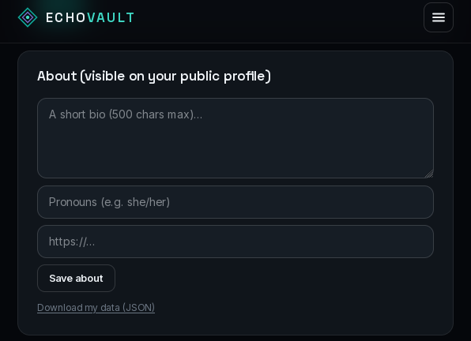
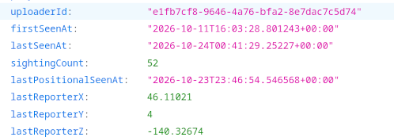
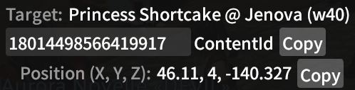

With new **Lodestone** codes becoming generic and the `HTTP 409` **Conflict**
exploit still not yielding new results... it was time for a new exploit! This
one combines the in-game position of EchoVault contributors with the reporters
X,Y,Z coordinates that was available in a JSON for claimed characters. By using
our own characters as bait and using EchoVault's `/api/me` endpoint, we could
compare those reporter coordinates with the coordinates of characters nearby.
This worked well because nobody moves in this game!

A big thanks to
[u/Particular-Side-3994](https://www.reddit.com/user/Particular-Side-3994/)
for sharing his tools and findings.





















We're publishing those findings since the **Position** exploit is also fixed.
All I will say for now is that there's more exploitable data so this won't
be the end of the **Sunnie Sunday Report** just yet.
