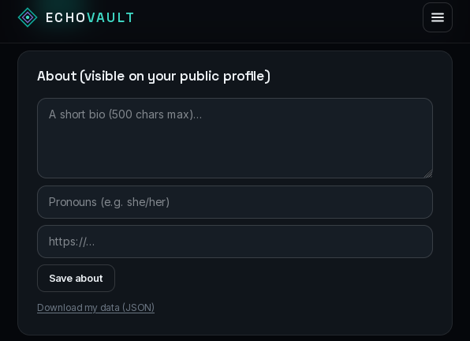
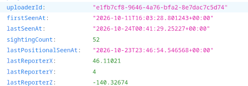
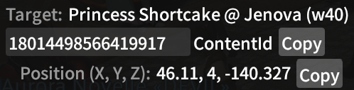

With new **Lodestone** codes becoming generic and the `HTTP 409` **Conflict**
exploit still not yielding new results... it was time for a new exploit! This
one combines the in-game position of EchoVault contributors with the reporters
X,Y,Z coordinates that was available in a JSON for claimed characters. By using
our own characters as bait and using EchoVault's `/api/me` endpoint, we could
compare those reporter coordinates with the coordinates of characters nearby.
This worked well because nobody moves in this game!



A big thanks to
[u/Particular-Side-3994](https://www.reddit.com/user/Particular-Side-3994/)
for sharing his tools and findings.

























```text
[2026-11-05 03:54:22] [Party]Quetz UrumetBalmung: what are u doing here btw?
[2026-11-05 03:58:13] [Party]T'sunnie Sunday: mostly watching over people. a little like you but without the sending that data to a remote server part.
[2026-11-05 03:59:11] [Party]Quetz UrumetBalmung: oh right, that thing
[2026-11-05 03:59:15] [Party]T'sunnie Sunday: unsure what your motivation is tbh
[2026-11-05 03:59:36] [Party]Quetz UrumetBalmung: have none, i genuinely forgot it exists until someone mentions it
[2026-11-05 03:59:50] [Party]T'sunnie Sunday: its obviously not very respectful to your own privacy either since we're having this conversation
[2026-11-05 04:01:31] [Party]Quetz UrumetBalmung: you do realize that ppl just kind of slap on all sorts of extras without much thought or research?
[2026-11-05 04:01:53] [Party]Quetz UrumetBalmung: it's just the game we play
[2026-11-05 04:06:32] [Party]T'sunnie Sunday: I do. But I don't see how you forgetting about it changes anything. you did the install process and the sightings were being sent...
[2026-11-05 04:08:15] [Party]Quetz UrumetBalmung: blame the game, hopefully SE enables some anti-cheat and players won't be able to be so easily manipulated
[2026-11-05 04:11:37] [Party]T'sunnie Sunday: SE does have a considerable liability in this issue but the plugin community at large has avoided using account IDs.
[2026-11-05 04:13:20] [Party]Quetz UrumetBalmung: On my part it was more of a whim, I see and I kind of just slap things on without much thought and forget about them like I said earlier but It's pretty uninteresting to me and I don't really get anything from it.
```

We're publishing those findings since the **Position** exploit is also fixed.
All I will say for now is that there's more exploitable data so this won't
be the end of the **Sunnie Sunday Report** just yet.
